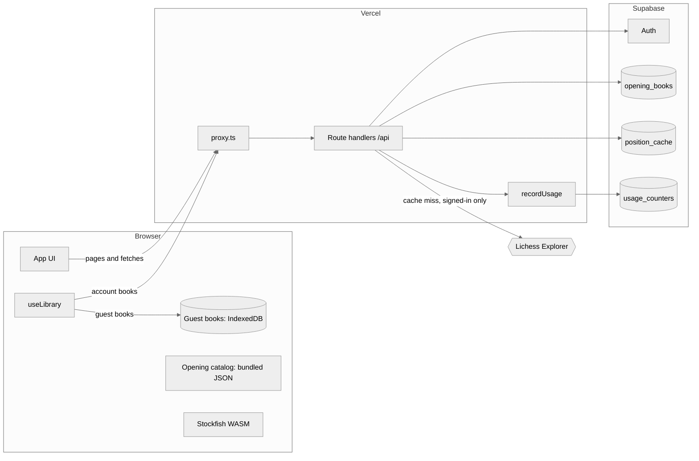
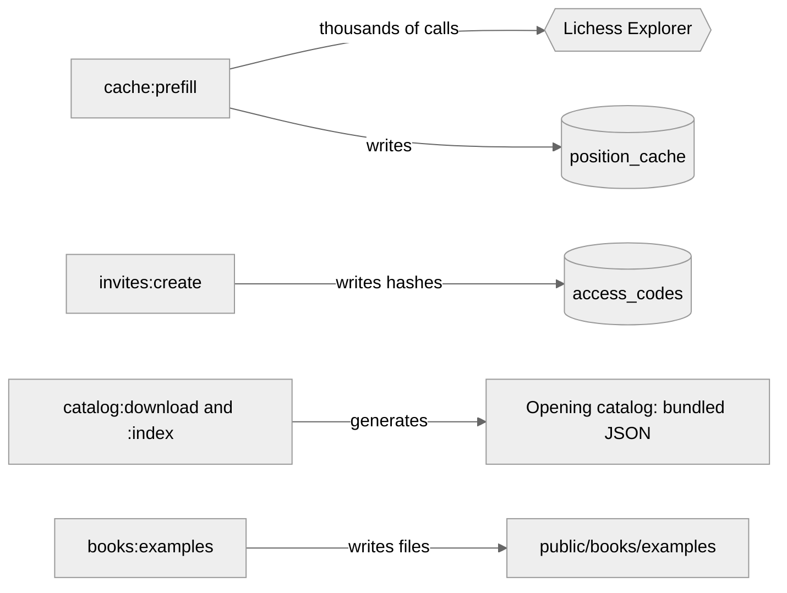

<!-- Mockup for plans/deployment.md: the tech stack drawn in Mermaid (compare tech-stack.html and tech-stack.excalidraw). Kept to small diagrams with plain labels, since Mermaid lays out large ones badly. -->

# ByTheBook tech stack (Mermaid)

## Runtime: who calls whom

## Scripts you run locally

